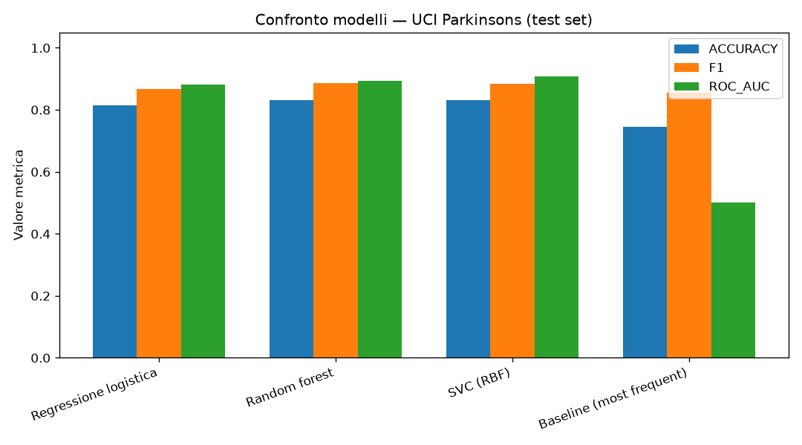
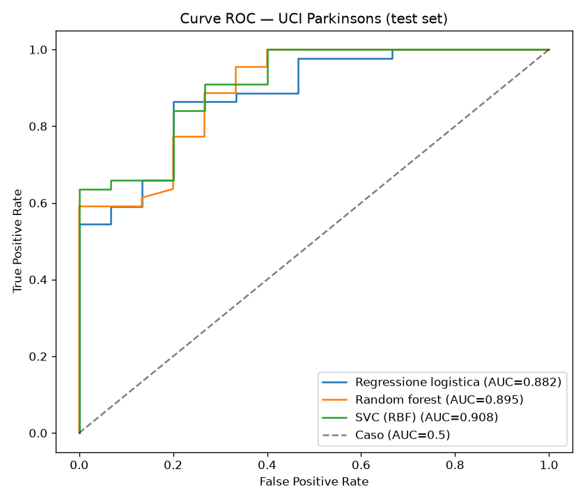

# 🧠 Parkinson · Classificazione da misure vocali

> Classificazione binaria **Parkinson vs sano** a partire da misure vocali (dysphonia) sul dataset **UCI Parkinsons**. Tre classificatori scikit-learn a confronto con una **baseline** onesta; con classi sbilanciate (~75% Parkinson) la metrica chiave e' la **ROC-AUC**. Pipeline riproducibile end-to-end (uv + `src/` + test offline + CI).



## Cosa dimostra

Rifattorizzazione di un vecchio esercizio (un solo notebook) in un **mini-progetto riproducibile** con gli stessi standard del portfolio:

1. **Confronto multi-modello** — regressione logistica, random forest e SVC (kernel RBF), tutti come `Pipeline` con `StandardScaler` e seed fisso.
2. **Baseline esplicita** — `DummyClassifier(strategy="most_frequent")`: con classi sbilanciate predire sempre la maggioranza da' gia' ~75% di accuracy, quindi qualunque modello utile deve battere questo riferimento. La ROC-AUC lo smaschera (≈0.5).
3. **Metriche oneste per classi sbilanciate** — accuracy, F1 e ROC-AUC insieme; la ROC-AUC (insensibile alla soglia) e' la piu' informativa.
4. **Test offline** — la CI non ha rete: i test girano su un generatore sintetico con la stessa forma del dataset reale.

## Pipeline

```
data/ (UCI Parkinsons)  ──download idempotente──►  load_parkinsons()
                                                        │
                                            split stratificato 70/30
                                                        │
        ┌───────────────────────┬───────────────────────┬───────────────────────┐
  Regr. logistica          Random forest             SVC (RBF)          Baseline (most freq.)
        └───────────────────────┴───────────────────────┴───────────────────────┘
                                                        ▼
                              results/metrics.json  +  figure (barplot, curve ROC)

test:  make_synthetic()  ──►  stessa forma del reale, ground-truth separabile (nessuna rete)
```

## Dataset

**UCI Parkinsons** (Little et al.): 195 registrazioni vocali sostenute da 31 soggetti (23 con Parkinson), **22 feature** di misure vocali (jitter, shimmer, HNR/NHR, RPDE, DFA, PPE, ...) piu' la colonna target `status` (1 = Parkinson, 0 = sano). La colonna `name` (identificativo) viene scartata. Classe **sbilanciata**: ~75% dei campioni sono Parkinson.

- **Fonte**: UCI Machine Learning Repository — `parkinsons.data` (download automatico, nessuna registrazione).
- **Licenza**: CC BY 4.0.

> Little MA, McSharry PE, Roberts SJ, Costello DAE, Moroz IM, *Suitability of dysphonia measurements for telemonitoring of Parkinson's disease*, IEEE Transactions on Biomedical Engineering, 2009. DOI: [10.1109/TBME.2008.2005954](https://doi.org/10.1109/TBME.2008.2005954)

## Come eseguire (uv)

```bash
uv sync --extra dev                          # crea .venv con Python 3.12 e installa tutto
uv run pytest -q                             # test rapidi OFFLINE (nessun download)
uv run ruff check .                          # lint
uv run python scripts/download_data.py       # scarica UCI Parkinsons in data/ (idempotente)
uv run python scripts/train.py               # addestra, valuta, scrive results/
uv run streamlit run app/main.py             # cruscotto dei risultati
```

## Risultati

Split stratificato 70/30 (`seed=0`), test = 59 campioni. Valori rigenerabili con `scripts/train.py`; figure in `results/`.

| Modello | Accuracy ↑ | F1 ↑ | ROC-AUC ↑ |
|--|:--:|:--:|:--:|
| Regressione logistica | 0.814 | 0.867 | 0.882 |
| Random forest | 0.831 | 0.886 | 0.895 |
| **SVC (RBF)** | 0.831 | 0.884 | **0.908** |
| Baseline (most frequent) | 0.746 | 0.854 | 0.500 |



> **Lettura onesta dei numeri**: la baseline raggiunge un'accuracy apparentemente alta solo perche' predice sempre la classe maggioritaria (Parkinson), ma ha **ROC-AUC ≈ 0.5** (nessuna capacita' discriminativa) e F1 gonfiata dalla prevalenza. I tre classificatori la battono nettamente sulla ROC-AUC: e' li' che si vede il valore aggiunto del modello.

## Limiti

- Dataset **piccolo** (195 righe, 31 soggetti): stime ad alta varianza, un singolo split train/test.
- Le registrazioni multiple **per soggetto** non sono separate a livello di split: possibile leakage tra righe dello stesso paziente. Per una valutazione rigorosa servirebbe una cross-validation *group-aware* (per soggetto).
- Nessuna ottimizzazione degli iperparametri ne' della soglia decisionale.
- **Nessun uso clinico**: scopo dimostrativo/educativo.

## Licenza

Codice: MIT (vedi `LICENSE`). Dataset UCI Parkinsons: CC BY 4.0 (verifica i termini prima dell'uso).
